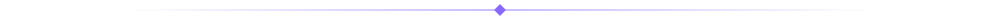

 

<a href="https://virtualpixel.es">web</a> &nbsp;·&nbsp;
<a href="https://tienda.virtualpixel.es">tienda</a> &nbsp;·&nbsp;
<a href="https://discord.gg/virtualpixel">discord</a> &nbsp;·&nbsp;
<a href="https://x.com/VirtualPixelMC">x</a> &nbsp;·&nbsp;
<a href="https://www.instagram.com/virtualpixeles/">instagram</a> &nbsp;·&nbsp;
<a href="https://github.com/VirtualPixel-Network">organización</a>

  

Soy <b>Carlin</b>. Llevo y programo <b>VirtualPixel</b>, un network de Minecraft en español 
para España y Latinoamérica, en Java y Bedrock.

 

<h3>◦ proyectos ◦</h3>

<table>
  <tr>
    <td align="center" width="33%">
      <a href="https://virtualpixel.es"><b>VirtualPixel</b></a> 
      dueño y desarrollador
    </td>
    <td align="center" width="33%">
      <a href="https://haliacraft.com"><b>HaliaCraft</b></a> 
      ceo
    </td>
    <td align="center" width="33%">
      <b>Oblicua Studio</b> 
      diseño y modelado
    </td>
  </tr>
  <tr>
    <td align="center">
      <a href="https://uranocraft.net"><b>UranoCraft</b></a> 
      manager
    </td>
    <td align="center">
      <a href="https://sayer.live"><b>Sayer</b></a> 
      manager
    </td>
    <td align="center">
      <b>Hildairis</b> 
      dueño · cerrado
    </td>
  </tr>
</table>

 

<h3>◦ plugins ◦</h3>

<code>VirtualCoins</code> <code>VirtualClans</code> <code>VirtualMarket</code> <code>VirtualCrates</code> <code>VirtualHomes</code> 
<code>VirtualKoth</code> <code>VirtualDailyQuest</code> <code>VirtualTranslate</code> <code>VirtualProxy</code>

La suite <code>Virtual</code>, en <a href="https://github.com/VirtualPixel-Network">VirtualPixel-Network</a>

 

<h3>◦ stack ◦</h3>

